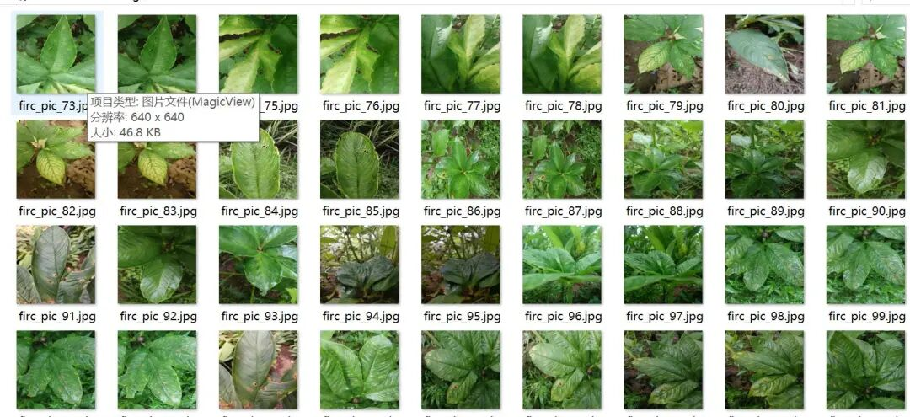
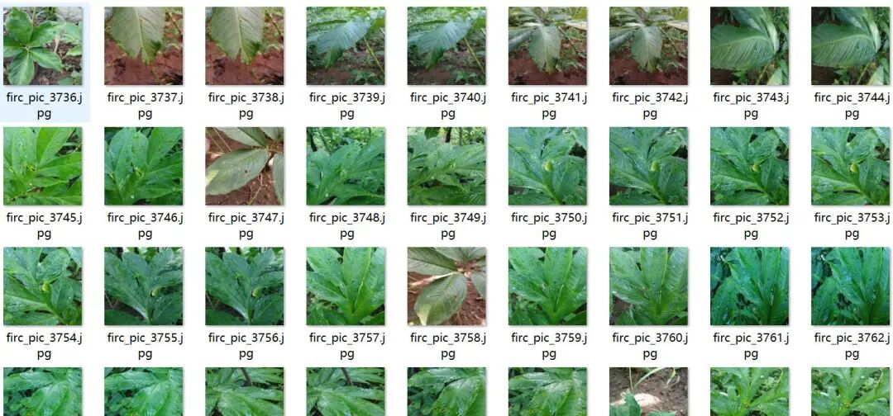
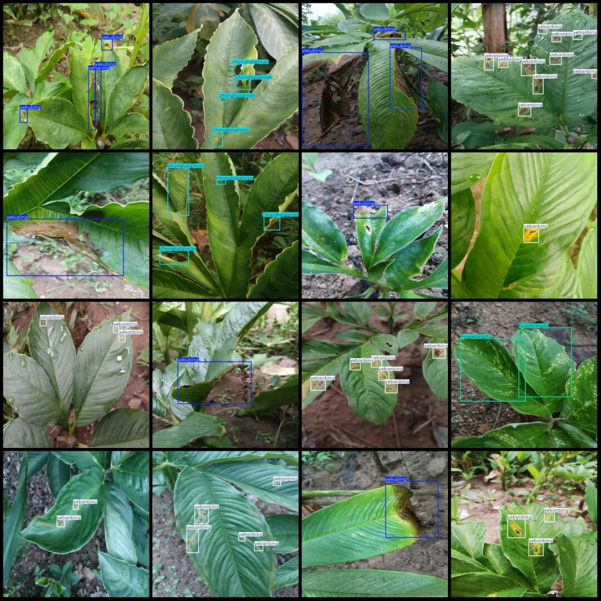
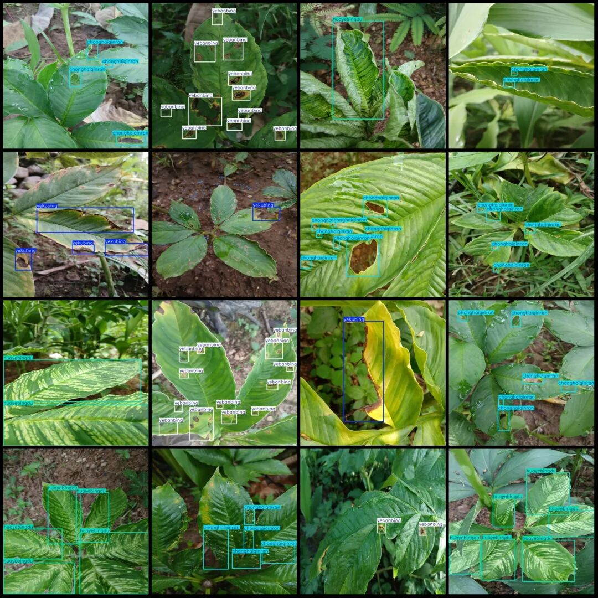

# Mozu Leaf Disease Detection Dataset VOC+YOLO format with 4 categories, 4325 images

Dataset format: Pascal VOC format + YOLO format (txt file without split path, only containing jpg images and corresponding VOC format xml files and yolo format txt files)

Number of images (number of jpg files): 4325

Number of annotations (number of xml files): 4325

Number of annotations (number of txt files): 4325

Labeling category count: 4

Label category names (note that the order of categories in the Yolo format does not correspond to this, but is based on the labels folder's classes.txt): ["chonghaiqinran", "huayebing", "yebanbing", "yekubing"]

Corresponding Chinese category name: [ "Insect Infestation", "Leaf Spot Disease", "Leaf Blight", "Leaf wither Disease"]

Number of boxes labeled in each category:

chonghaiqinran frame count = 4511

Huayebingdu Frames = 2978

yebanbing frame count = 4819

Yekubing Frame Count = 2234

Total frame count: 14542

Number of images per category:

chonghaiqinran occupies = 1036

huayebingdu occupies = 1062

Yebanbing owns 1246 images.

Yekubing occupies the number of images = 1017

Image resolution: 640x640

Using labelImg:

Annotation rules: Draw a rectangle around the category.

Important Notice: The dataset does not have separate training, validation, and test sets; you need to partition them yourself.

Special : This dataset does not guarantee the accuracy of the trained models or weight files.

Image Preview:

Annotation example:

## Payment

Here is a pay link on Stripe ( https://buy.stripe.com/3cs8yP7sY87d0vu9AB ). Please contact me lonlonago@foxmail.com after funding $89, and I will send you a complete data files , thank you!

